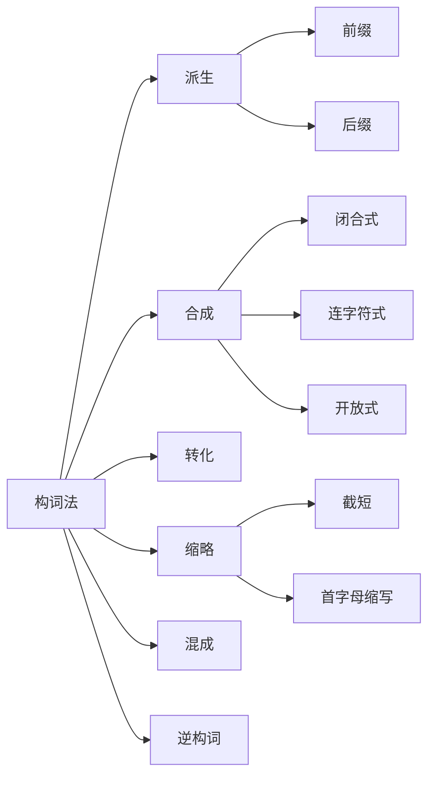

## 参考资料

- [英语语法精讲合集：构词法 - 英语兔](https://www.bilibili.com/video/BV1XY411J7aG?p=22)
- [Word formation - Cambridge Dictionary](https://dictionary.cambridge.org/us/grammar/british-grammar/word-formation_2)
- [babysit - Merriam-Webster](https://www.merriam-webster.com/dictionary/babysit)
- [non-smoking - Cambridge Dictionary](https://dictionary.cambridge.org/dictionary/english/non-smoking)
- [legible - Cambridge Dictionary](https://dictionary.cambridge.org/dictionary/english/legible)
- [readable - Cambridge Dictionary](https://dictionary.cambridge.org/dictionary/english/readable)

## 简介

**构词法**（Word Formation）研究新词或新词类用法如何形成，包括添加词缀、组合已有成分、缩短词形等方式。

常见构词方式包括 **派生**、**合成**、**转化**、**缩略**、**混成**。这是一种教学归类，不是穷尽一切词汇来源的封闭分类；借词、逆构词等也会产生新词。

词缀可提示词类与部分词义，具体义项仍需结合语境和词典核对。

## 构词与屈折

|          类型          |       改变内容       |                     示例                     |
| :--------------------: | :------------------: | :------------------------------------------: |
| 构词（Word Formation） | 形成新词或新词类用法 |     happy → happiness；email → to email      |
|   屈折（Inflection）   |   同一词的语法形式   | book → books；write → wrote；small → smaller |

因此，studies、studied 不宜和 happiness 一概归为派生。派生词缀可与屈折词缀叠加：teach → teacher → teachers，先形成名词，再标记复数。

拼写相同的词缀也可能功能不同：teacher 中的 -er 构成表示人的名词，smaller 中的 -er 标记比较级，不能仅凭字母相同就归为同一种变化。

## 词根、词基与词缀

|     概念      |                        含义                        |                       示例                        |
| :-----------: | :------------------------------------------------: | :-----------------------------------------------: |
| 词根（Root）  | 在当前分析中不能再分为更小词根与词缀的核心词汇成分 |           helpful、unhelpful 中的 help            |
| 词基（Base）  |  某一步构词所依附的基础，可以是词根或更复杂的结构  | help + -ful 中的 help；un- + helpful 中的 helpful |
| 词缀（Affix） |         附着于词基的成分，分为前缀、后缀等         |                 un-、-ful、-ness                  |

识别词根、词基和词缀时，也要分清现代使用者的可分析结构与历史词源。拼写恰好相似，不保证能用同一套规则推导词义。

词缀可以分层组合：help → helpful → unhelpful → unhelpfulness。不能把所有复杂词都压成「一个前缀 + 一个词根 + 一个后缀」。有些词根不能单独成词，如 visible 中表示「看」的历史成分 vis；它也不意味着凡是包含 vis 的词都与视觉有关。

英语词汇包含日耳曼语、法语、拉丁语、希腊语等不同来源，但 **词源与构词方式是两个维度**。readable 由 read 与后缀 -able 构成，属于派生，不能因 read 是日耳曼来源就归入合成；合成也不要求组成部分都来自同一种语言。

## 派生法

**派生法**（Derivation）通过在词基上添加 **前缀** 或 **后缀** 构成新词。词基可以是词根，也可以是已经形成的词。

### 前缀

**前缀**（Prefix）通常改变词义而保留词类，如 happy → unhappy；也有改变词类的例子，如 danger（名词）→ endanger（动词）。

前缀不能任意替换。形容词的否定形式要查词典，如 unhappy、impossible、dishonest，不能根据「意思是否合理」自行创造标准词形。

|    语义类型    |                 常见前缀                  |                                 示例                                  |
| :------------: | :---------------------------------------: | :-------------------------------------------------------------------: |
| **否定或偏差** | un-, in-, im-, ir-, il-, dis-, non-, mis- |        unhappy（不开心的）、illegal（非法的）、misread（误读）        |
|  **数量意义**  |   uni-, bi-, tri-, multi-, semi-, poly-   |      bicycle（自行车）、triangle（三角形）、multimedia（多媒体）      |
| **时间与位置** | pre-, post-, sub-, super-, inter-, trans- |         preview（预览）、submarine（潜艇）、interact（互动）          |
|  **程度意义**  |   over-, under-, hyper-, hypo-, ultra-    | overwork（过度劳累）、underestimate（低估）、hypersonic（高超声速的） |
| **重复或返回** |                    re-                    |                    rewrite（重写）、reread（重读）                    |
| **共同或相互** |           co-, com-, con-, syn-           |         cooperate（合作）、connect（连接）、synonym（同义词）         |

|   前缀   |             含义 / 用法              |                       例词                        |               中文含义               |
| :------: | :----------------------------------: | :-----------------------------------------------: | :----------------------------------: |
|   un-    | 常见的否定前缀，表示「不、未或相反」 |             unhappy, unfair, unknown              |      不开心的、不公平的、未知的      |
|   in-    |      表示否定，常见于拉丁来源词      |               invisible, incomplete               |          看不见的、不完整的          |
|   im-    |    in- 的变体，用于 b / p / m 前     |           impossible, impolite, immoral           |     不可能的、不礼貌的、不道德的     |
|   il-    |        in- 的变体，用于 l 前         |                illegal, illogical                 |          非法的、不合逻辑的          |
|   ir-    |        in- 的变体，用于 r 前         |             irregular, irresponsible              |         不规律的、不负责任的         |
|   non-   |     中性否定，表示「非、不属于」     |         non-smoking, non-profit, nonhuman         | 不吸烟的／禁烟的、非营利的、非人类的 |
|   dis-   |      表示否定、相反、分离或取消      |           dislike, disagree, disconnect           |       不喜欢、不同意、断开连接       |
|   mis-   |          表示错误地、不当地          |          misunderstand, misread, misuse           |           误解、误读、误用           |
|  anti-   |         表示反对、抵抗、对抗         |          anti-war, antibiotic, antivirus          |       反战的、抗生素、杀毒软件       |
| counter- |         表示反向、反制、对抗         | counterattack, counterargument, counterproductive |      反击、反驳论点、适得其反的      |
|   de-    |      表示去除、降低、解除或反向      |           deactivate, decode, deforest            |         停用、解码、砍伐森林         |
| a- / an- |   表示没有、缺乏，常见于希腊来源词   |            atypical, anonymous, amoral            |    非典型的、匿名的、无道德属性的    |

表中兼收现代仍能生成新词的词缀和借词中可辨认的历史成分，不能据此任意拼词。同一拼写也可能意义不同：否定前缀 in- 与 inward、inscribe 中表示「向内」的成分不能混为一谈。non-smoking 修饰人时表示不吸烟，修饰场所时表示不允许吸烟。

### 后缀

派生中的 **后缀**（Suffix）常改变词类，也可改变词义。

同一后缀不必总改变词类，如 friend → friendship 仍是名词。-ly 常构成副词，但 friendly、lovely 是形容词；判断词类还需查看句法分布。

|    词类    |                      常见后缀                      |                                   示例                                    |
| :--------: | :------------------------------------------------: | :-----------------------------------------------------------------------: |
|  **名词**  | -tion, -sion, -ness, -ment, -ity, -ance, -er, -ist |   action（行动）、happiness（幸福）、payment（付款）、runner（跑步者）    |
| **形容词** |   -ful, -less, -ous, -al, -ive, -able, -ic, -ish   | useful（有用的）、careless（粗心的）、active（活跃的）、magical（神奇的） |
|  **副词**  |                     -ly, -ward                     |                   quickly（快速地）、backward（向后地）                   |
|  **动词**  |            -ize, -ify / -fy, -en, -ate             |         modernize（使现代化）、simplify（简化）、soften（使变软）         |

:::example

- happy（快乐的）（形）+ -ness $\to$ happiness（名）
- modern（现代的）（形）+ -ize $\to$ modernize（动）
- use（用途）（名）+ -ful $\to$ useful（形）
- quick（快的）（形）+ -ly $\to$ quickly（副）

:::

表格按所列用法归类，不穷尽每个词的词类。例如 She stepped **backward**. 中 backward 是副词，但 backward 也有形容词用法。

### 拼写变化

组合词基和词缀时，拼写不总是直接相连：

|        变化        |                    相关词形                    |
| :----------------: | :--------------------------------------------: |
|    省去词尾 -e     |             structure → structural             |
|  双写末尾辅音字母  |                 red → reddish                  |
|    -y 改为 -i-     |               happy → happiness                |
| 词基形式有较大变化 | maintain → maintenance；describe → description |

-able 与 -ible 也不能仅凭意思互换，如 countable、visible。词根能否独立成词只能提供部分线索，具体词形仍应查词典。不宜把所有拼写变化都解释为临时「为了好发音」；历史来源、词族关系与拼写惯例也会影响形式。

中文释义相近也不保证用法完全相同。legible 常指字迹或印刷清楚到容易辨认，如 legible handwriting；readable 常指内容易读、有趣，如 a readable account。不能只记成两个来源不同、意义完全相同的「可读的」。

## 合成法

**合成法**（Compounding）将两个或多个词或词基组合为新词。

按拼写形式可分为 3 类：

- **闭合式**（无空格）：notebook, blackboard, sunshine
- **连字符式**：mother-in-law, well-known, twenty-one
- **开放式**（带空格）：high school, ice cream, post office

按现代词形结构及当前词类，可举出：

|      类型      |                                   示例                                    |
| :------------: | :-----------------------------------------------------------------------: |
|  **合成名词**  |          blackboard（黑板）、classroom（教室）、sunlight（阳光）          |
| **合成形容词** | good-looking（好看的）、world-famous（世界闻名的）、blue-eyed（蓝眼睛的） |
|  **合成动词**  |       stir-fry（翻炒）、hand-wash（用手洗）、freeze-dry（冷冻干燥）       |
|  **合成副词**  |                    however（然而）、somewhere（某处）                     |

:::tip

合成词的拼写形式没有严格规则，应以 **词典** 为准。同一词的拼写可能随时代变化。

:::

## 转化法

**转化法**（Conversion）是词的形态不变，词类发生转化的构词方式。

常见转化方向：

- **名词** $\to$ **动词**：water $\to$ to water，email $\to$ to email
- **动词** $\to$ **名词**：to run $\to$ a run，to walk $\to$ a walk
- **形容词** $\to$ **动词**：empty $\to$ to empty，dry $\to$ to dry
- **形容词** $\to$ **名词**：regular（经常的）$\to$ a regular（常客）

:::example

- I will **water** the flowers.（我会给花浇水。）（名词 $\to$ 动词）
- Let's go for a **walk**.（我们去散步吧。）（动词 $\to$ 名词）
- She is a **regular** at this café.（她是这家咖啡馆的常客。）（形容词 $\to$ 名词）

:::

the rich、the young 在传统教学中常称「形容词名词化」，现代分析也可把它们看作形容词在名词短语中兼任中心。作主语或宾语是句法功能，不能仅凭功能断定词类已经改变。

## 缩略法

**缩略法**（Shortening）将原词截取或缩写，构造便于使用的短词。

### 截短

**截短**（Clipping）只保留原词的一部分。

:::example

- advertisement（广告）$\to$ ad
- examination（考试）$\to$ exam
- laboratory（实验室）$\to$ lab
- telephone（电话）$\to$ phone
- influenza（流行性感冒）$\to$ flu

:::

### 首字母缩写

缩略词常取多词短语的首字母，也可结合词首片段；功能词有时不保留。

按读法分为 2 类：

- **逐字母读**（Initialism）：CPU, USA, FBI
- **整体拼读**（Acronym）：NASA, radar, laser

:::example

- Central Processing Unit（中央处理器）$\to$ CPU
- National Aeronautics and Space Administration（美国国家航空航天局）$\to$ NASA
- Light amplification by stimulated emission of radiation（受激辐射光放大）$\to$ laser
- International English Language Testing System（国际英语语言测试系统，雅思）$\to$ IELTS
- Test of English as a Foreign Language（托福）$\to$ TOEFL

:::

radar 来自 radio detection and ranging，其中 ra- 取自 radio 的词首，不是机械地每词只取一个字母。radar、laser 等已词汇化，通常用小写。app 来自 application 的截短，通常读作一个词，不属于逐字母拼读的首字母缩写。

## 混成法

**混成法**（Blending）将两个词的部分拼合，构造新词。

:::example

- breakfast（早餐）+ lunch $\to$ brunch
- smoke（烟）+ fog $\to$ smog
- motor（汽车）+ hotel $\to$ motel
- internet（互联网）+ citizen $\to$ netizen

:::

brunch、smog 是典型混成词。web + log 先形成合成词 weblog，再缩短成 blog；不能把各种缩短都强行解释为同一种拼合法。

## 逆构词与词族

**逆构词**（Back-Formation）从已有词中去掉被分析为词缀的部分，形成新词，如 editor → edit、babysitter → babysit。它描述的是词的形成方向，不能仅凭词形较短就认定它历史上更早。babysit 的现代词形能分析出 baby 与 sit，不等于它历史上直接由两词合成；结构分析与历史形成方向要分开。

构词关系适合按词族学习：decide（动词）、decision（名词）、decisive（形容词）、decisively（副词）。词族中的拼写、发音和重音可能变化，不能总按「原词直接拼后缀」处理。

做词形填空时，先根据句法确定所需词类，再看肯否定、单复数和具体搭配。例如 a `___` decision 需要修饰 decision 的形式；这还不足以在 decisive、difficult 等词义之间选择，必须结合上下文。

## 自测

1. teacher → teachers 属于构词还是屈折？teach → teacher 呢？
2. friendly 是否因为以 -ly 结尾就是副词？
3. 是否能把 unhappy 的 un- 任意换成 in-？
4. 为什么不能仅凭 the rich 作主语就断言 rich 是普通名词？

答案与解析

1. 前者是复数屈折；后者通过 -er 形成新名词，属于派生；
2. 不是。friendly 通常是形容词，须根据词典和句法判断词类；
3. 不能。词缀的选择受词汇惯例限制，需核对实际词形；
4. 主语是功能，名词是词类；形容词结构也可以占据名词短语的中心位置，不同体系有不同分析。

## 思维导图

