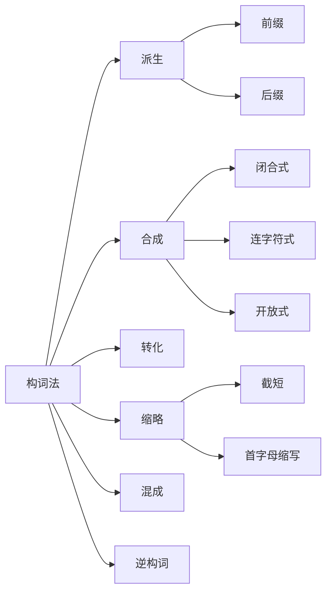

## 参考资料

- [英语语法精讲合集：构词法 - 英语兔](https://www.bilibili.com/video/BV1XY411J7aG?p=22)
- [Word formation - Cambridge Dictionary](https://dictionary.cambridge.org/us/grammar/british-grammar/word-formation_2)
- [babysit - Merriam-Webster](https://www.merriam-webster.com/dictionary/babysit)
- [non-smoking - Cambridge Dictionary](https://dictionary.cambridge.org/dictionary/english/non-smoking)
- [legible - Cambridge Dictionary](https://dictionary.cambridge.org/dictionary/english/legible)
- [readable - Cambridge Dictionary](https://dictionary.cambridge.org/dictionary/english/readable)

## 简介

**构词法**（Word Formation）研究新词或新词类用法的形成方式：

- **派生**：添加词缀，如 happy → unhappy。
- **合成**：组合成分，如 black + board → blackboard。
- **转化**：保持词形，改变词类用法，如 water → to water。
- **缩略**：缩短或缩写词形，如 examination → exam。
- **混成**：拼合不同词的片段，如 breakfast + lunch → brunch。
- **逆构词**：从已有词中减去被当作词缀的部分，如 editor → edit。

借词等途径也能增加词汇，不全部归入以上构词方式。

## 构词与屈折

- **构词**（Word Formation）：形成新词或新词类用法，如 happy → happiness、email → to email。
- **屈折**（Inflection）：改变同一词的语法形式，如 book → books、write → wrote、small → smaller。

按每一步的作用判断：

1. teach → teacher：添加派生后缀，形成名词；
2. teacher → teachers：添加复数屈折，仍是同一个名词；
3. teacher 中的 -er 表示人，smaller 中的 -er 表示比较级，拼写相同不代表功能相同。

## 词根、词基与词缀

### 基本单位

- **词根**（Root）：当前分析中不能再分为更小词根与词缀的核心词汇成分，如 helpful、unhelpful 中的 help。
- **词基**（Base）：某一步构词所依附的基础，可以是词根，也可以是已经构成的词。
- **词缀**（Affix）：附着于词基的成分；按位置区分前缀和后缀。

例如 help → helpful → unhelpful → unhelpfulness：

1. help + -ful：词基是 help；
2. un- + helpful：词基是 helpful；
3. unhelpful + -ness：词基是 unhelpful。

词基随构词步骤改变，不必把每个复杂词压成「一个前缀 + 一个词根 + 一个后缀」。

### 结构与词源

分别判断3个问题：

1. **现代结构**：当前使用者能识别哪些构词成分；
2. **历史来源**：词或成分从哪种语言、按什么顺序进入英语；
3. **当前词义**：这个词在所用语境中表达什么。

这3项不能相互替代：

- visible 中表示「看」的历史成分 vis 不能独立成词；含有相同字母的其他词不一定具有相同词源。
- readable 由 read 与 -able 派生，不能因 read 来自日耳曼语就判为合成。
- 合成不要求所有成分来自同一种语言。

## 派生法

**派生法**（Derivation）在词基上添加前缀或后缀。先确定所需意义与词类，再选择词族中实际使用的词缀，最后处理拼写。

### 前缀

**前缀**（Prefix）位于词基前：

- happy → unhappy：改变词义，仍是形容词。
- danger → endanger：改变词义，同时由名词形成动词。

以下按所列义项归组；前缀选择受词族约束，不能仅因中文释义相近就替换。

1. **否定、缺乏或反向**：
   - **un-**：不、未或相反，如 unhappy（不开心的）、unfair（不公平的）、unknown（未知的）。
   - **in-**：否定前缀，如 invisible（看不见的）、incomplete（不完整的）；其书写变体见下文。
   - **non-**：非、不属于，如 non-profit（非营利的）、nonhuman（非人类的）。
   - **dis-**：否定、相反、分离或取消，如 dislike（不喜欢）、disagree（不同意）、disconnect（断开连接）。
   - **a- / an-**：没有、缺乏，见于希腊来源词，如 atypical（非典型的）、anonymous（匿名的）、amoral（无道德属性的）。
2. **错误或对抗**：
   - **mis-**：错误地、不当地，如 misunderstand（误解）、misread（误读）、misuse（误用）。
   - **anti-**：反对、抵抗，如 anti-war（反战的）、antibiotic（抗生素）、antivirus（杀毒软件）。
   - **counter-**：反向、反制，如 counterattack（反击）、counterargument（反驳论点）、counterproductive（适得其反的）。
3. **去除、降低或解除**：
   - **de-**：如 deactivate（停用）、decode（解码）、deforest（砍伐森林）。
4. **数量**：
   - **uni-、bi-、tri-、multi-、semi-、poly-**：如 bicycle（自行车）、triangle（三角形）、multimedia（多媒体）。
5. **时间、位置与程度**：
   - **pre-、post-、sub-、super-、inter-、trans-**：如 preview（预览）、submarine（潜艇）、interact（互动）。
   - **over-、under-、hyper-、hypo-、ultra-**：如 overwork（过度劳累）、underestimate（低估）、hypersonic（高超声速的）。
6. **重复、返回或共同关系**：
   - **re-**：重复或返回，如 rewrite（重写）、reread（重读）。
   - **co-、com-、con-、syn-**：共同或相互，如 cooperate（合作）、connect（连接）、synonym（同义词）。

**否定 in- 的变体** 按两层判断：

1. 先确定该词的否定形式属于 in- 词族；popular 的否定是 unpopular，不能因 p 开头就改用 im-；
2. 在这一词族中，按后接词基的首字母选择书写形式：
   - b、p、m 前用 **im-**，如 impossible、impolite、immoral。
   - l 前用 **il-**，如 illegal、illogical。
   - r 前用 **ir-**，如 irregular、irresponsible。
   - 其他对应形式保留 **in-**，如 invisible、incomplete。

同形前缀与修饰范围还需分别判断：

- inward、inscribe 中表示「向内」的成分，不属于这里的否定 in-。
- non-smoking 修饰人时表示不吸烟，修饰场所时表示不允许吸烟。
- 上述词缀有些仍能生成新词，有些主要作为借词的历史成分保留，不能据列表任意拼词。

### 后缀

**后缀**（Suffix）位于词基后。按所列用法形成的词类归组：

- **名词后缀**：-tion、-sion、-ness、-ment、-ity、-ance、-er、-ist。
  - action（行动）、happiness（幸福）、payment（付款）、runner（跑步者）。
  - happy（形容词）+ -ness → happiness（名词）。
- **形容词后缀**：-ful、-less、-ous、-al、-ive、-able、-ic、-ish。
  - useful（有用的）、careless（粗心的）、active（活跃的）、magical（神奇的）。
  - use（名词）+ -ful → useful（形容词）。
- **副词后缀**：-ly、-ward 等。
  - quick（形容词）+ -ly → quickly（副词）。
  - 「She stepped **backward**.」中 backward 是副词；它也有形容词用法。
- **动词后缀**：-ize、-ify / -fy、-en、-ate。
  - modern（形容词）+ -ize → modernize（动词）。
  - simplify（简化）、soften（使变软）。

后缀作用不能只凭字母判定：

- friend → friendship：改变词义，前后都是名词。
- friendly、lovely 中的 -ly 形成形容词，不能套用副词派生规则。
- 派生后的词还可以继续屈折，如 modernize → modernizes。

### 词形选择与拼写

按以下顺序分析已存在的派生词：

1. **确定词义与目标词类**：先确认实际词形，不任意替换后缀；
2. **识别词族中的词基形式**：maintain → maintenance、describe → description 的词基不能只按字母直接拼接；
3. **处理选定组合的拼写**：
   - structure + -al → structural：省去末尾 e。
   - red + -ish → reddish：双写末尾 d。
   - happy + -ness → happiness：y 变为 i。
   - 这些操作对应不同构词组合，不构成「所有词缀先去 e、再双写」的统一指令。
4. **检查读音与搭配**：同一词族的拼写、发音及重音可能改变。

详细拼写规则按所选变化分别处理：

- 形容词加 -ly：见 [副词](/docs/note/english/grammar/parts-of-speech/adverbs)。
- 比较级、最高级：见 [形容词](/docs/note/english/grammar/parts-of-speech/adjectives)。
- 动词词形：见 [动词时态](/docs/note/english/grammar/verbs/verb-tenses)。
- 名词复数：见 [名词](/docs/note/english/grammar/parts-of-speech/nouns)。

-able 与 -ible 的选择不能只看中文释义或词根是否独立成词，如 countable、visible。相近释义还可能对应不同搭配：

- **legible**：字迹或印刷清楚到容易辨认，如 legible handwriting。
- **readable**：内容易读、有趣，如 a readable account。

## 合成法

**合成法**（Compounding）将两个或多个词或词基组合为新词。生成词类与书写形式分别判断。

### 结果词类

- **合成名词**：blackboard（黑板）、classroom（教室）、sunlight（阳光）。
- **合成形容词**：good-looking（好看的）、world-famous（世界闻名的）、blue-eyed（蓝眼睛的）。
- **合成动词**：stir-fry（翻炒）、hand-wash（用手洗）、freeze-dry（冷冻干燥）。
- **合成副词**：however（然而）、somewhere（某处）。

### 书写形式

- **闭合式**：无空格，如 notebook、blackboard、sunshine。
- **连字符式**：以连字符连接，如 mother-in-law、well-known、twenty-one。
- **开放式**：带空格，如 high school、ice cream、post office。

书写形式由具体词的拼写惯例确定，不能从词类直接推出。同一词的拼写也可能随时代变化。

## 转化法

**转化法**（Conversion）保持词形，改变词类用法：

- **名词** $\to$ **动词**：water → to water、email → to email。
  - 「I will **water** the flowers.」（我会给花浇水。）
- **动词** $\to$ **名词**：to run → a run、to walk → a walk。
  - 「Let's go for a **walk**.」（我们去散步吧。）
- **形容词** $\to$ **动词**：empty → to empty、dry → to dry。
- **形容词** $\to$ **名词**：regular（经常的）→ a regular（常客）。
  - 「She is a **regular** at this café.」（她是这家咖啡馆的常客。）

判断转化时，词类与句法功能分别处理：

- 作主语或宾语属于句法功能，不能据此认定某词已经转为普通名词。
- the rich、the young 在传统教学中称形容词名词化；现代分析也可视为形容词在名词短语中兼任中心。

## 缩略法

**缩略法**（Shortening）通过截短或缩写形成短词。先判断是否截取单词片段，再判断是否缩写多词名称。

### 截短

**截短**（Clipping）保留原词的一部分：

- advertisement（广告）→ ad。
- examination（考试）→ exam。
- laboratory（实验室）→ lab。
- telephone（电话）→ phone。
- influenza（流行性感冒）→ flu。
- application（应用程序）→ app；这是截短，不是按字母读的首字母缩写。

### 首字母缩写

缩写多词名称时，可选取首字母或词首片段，并按读法区分：

1. **逐字母读**（Initialism）：CPU、USA、FBI；
2. **整体拼读**（Acronym）：NASA、radar、laser。

例如：

- Central Processing Unit（中央处理器）→ CPU。
- National Aeronautics and Space Administration（美国国家航空航天局）→ NASA。
- Light amplification by stimulated emission of radiation（受激辐射光放大）→ laser。
- International English Language Testing System（国际英语语言测试系统，雅思）→ IELTS。
- Test of English as a Foreign Language（托福）→ TOEFL。

构造和大小写分别判断：

- radar 来自 radio detection and ranging，ra- 取自 radio 的词首，并非每词恰取一个字母。
- radar、laser 已词汇化为普通词，普通用法以小写书写。
- 缩写中可省略功能词，不能从缩写的长度反推原名称的词数。

## 混成法

**混成法**（Blending）拼合两个词的片段：

- breakfast（早餐）+ lunch → brunch。
- smoke（烟）+ fog → smog。
- motor（汽车）+ hotel → motel。
- internet（互联网）+ citizen → netizen。

形成过程可以包含多步：web + log 先合成 weblog，再截短为 blog，不能把所有缩短一概归为混成。

## 逆构词与词族

**逆构词**（Back-Formation）从已有词中去掉被分析为词缀的部分，形成新词：

- editor → edit。
- babysitter → babysit。

分析时区分两个方向：

- **历史形成方向**：已有词在先，减去被当作词缀的部分后形成新词；较短的词不必较早出现。
- **现代结构分析**：babysit 能分出 baby 与 sit，不代表其历史上直接由两词合成。

词族可同时记录词类与形式，如 decide（动词）→ decision（名词）→ decisive（形容词）→ decisively（副词）。该排列展示相关词项，不断言每一步都是历史上的直接来源。

分析「She answered **confidently**.」时：

1. **词类**：confidently 是由 confident 加 -ly 形成的副词；
2. **功能**：confidently 在本句作方式状语，修饰 answered；
   - 相同功能也可由介词短语承担，如「She answered **with confidence**.」。
3. **意义**：按语境理解为自信地，句法位置不能唯一确定词义。

## 思维导图

